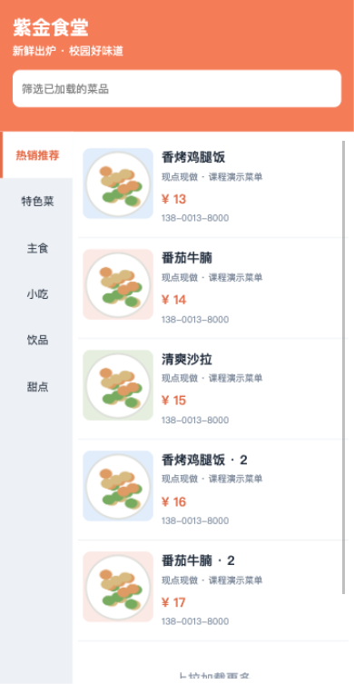
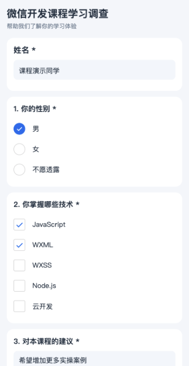

# 微信公众平台开发课程六个实验

本项目包含《微信公众平台开发》课程的六个独立微信小程序、四套本地Node.js服务、六份按学校原模板填写的实验报告，以及26张真实运行截图。学生：**崔子霖，2315302125**。

六个实验的必做功能已完成三个交付层次：代码与配置齐全；成功导入微信开发者工具并完成交互验收；代码、报告及运行截图相互对应。2026年10月12日的48项检查全部通过。运行证据来自开发者工具模拟器；实验5云开发选做已有代码，真实云部署尚未完成。

## 内容导航

- [实验概览](#实验概览)
- [界面预览](#界面预览)
- [目录结构](#目录结构)
- [开发环境](#开发环境)
- [下载与运行](#下载与运行)
- [六个实验演示步骤](#六个实验演示步骤)
- [报告和原模板](#报告和原模板)
- [本地服务接口](#本地服务接口)
- [测试与截图复现](#测试与截图复现)
- [实验5云开发选做](#实验5云开发选做)
- [常见问题](#常见问题)
- [素材与验收范围](#素材与验收范围)

## 实验概览

|实验|项目目录|必做功能|拓展功能|本地服务|
|---|---|---|---|---|
|1 本地生活|[experiment-01-local-life](experiment-01-local-life/)|轮播、九宫格、Flex布局、公共样式、页面跳转|主动选择头像、昵称与本地保存|无需服务|
|2 婚礼邀请函|[experiment-02-wedding](experiment-02-wedding/)|四个tabBar页面、纵向相册、视频、宾客表单、HTTP提交|背景音乐与实际播放状态控制|3002|
|3 计算器|[experiment-03-calculator](experiment-03-calculator/)|四则运算、事件取值、calc与math模块、13位限制、异常与断点|浅色/深色主题和主题记忆|无需服务|
|4 美食列表|[experiment-04-food-list](experiment-04-food-list/)|网络列表、WXS电话格式化、上拉加载、下拉刷新、数据绑定|左侧分类、已加载数据筛选|3004|
|5 调查问卷|[experiment-05-questionnaire](experiment-05-questionnaire/)|HTTP动态题目、单选、多选、输入、校验、数据绑定|本地持久化；云直连/云函数选做代码|3005|
|6 音乐播放器|[experiment-06-music-player](experiment-06-music-player/)|swiper、scroll-view、include、slider、背景音频、切歌|名称搜索、LRC同步、歌单、收藏、播放模式|3006|

## 界面预览

以下图片是开发者工具实际运行画面。完整截图保存在[screenshots](screenshots/)。

|本地生活|婚礼邀请函|计算器|
|---|---|---|
||||

|美食列表|调查问卷|音乐播放器|
|---|---|---|
||||

## 目录结构

```text
wechat-miniprogram-course-labs/
├── experiment-01-local-life/
├── experiment-02-wedding/
├── experiment-03-calculator/
├── experiment-04-food-list/
├── experiment-05-questionnaire/
│   ├── cloud/upsertUserData/        # 云函数选做代码
│   └── CLOUD_SETUP.md               # 真实环境配置与验收步骤
├── experiment-06-music-player/
├── reports/                         # 六份已填写Word报告
├── screenshots/                     # 按实验分组的26张实际截图
├── source/                          # 六份未修改的原始学校模板
├── tests/                           # 可复查脚本与实测记录
│   └── fixtures/                    # 对应截图回执的演示提交数据
├── start-servers.js                 # 启动四个本地服务
├── package.json                     # 运行/测试命令
├── manifest.json                    # 发布文件SHA-256清单
├── FINAL_ACCEPTANCE.md              # 三个层次的验收与范围说明
├── TEST_REPORT.md                   # 48项检查明细
├── TEMPLATE_FIDELITY.md              # 原模板保留说明
└── ASSETS.md                        # 素材与截图来源
```

每个实验根目录都有`project.config.json`与`project.private.config.json`，实际小程序源码位于`miniprogram/`。需要联网的实验另有`server/`。六个项目分别导入与运行。

## 开发环境

|项目|要求或已验证环境|
|---|---|
|小程序源码|JavaScript、WXML、WXSS；实验4包含WXS|
|服务端|Node.js 18及以上；仅使用Node内置模块|
|开发者工具|实测Stable 2.01.2510280，macOS|
|基础库|3.10.3，已在项目配置中固定|
|自动化测试依赖|miniprogram-automator 0.12.1，仅复查模拟器交互时需要|
|云函数选做依赖|wx-server-sdk ~3.0.1，位于实验5云函数目录|

## 下载与运行

### 1 下载仓库

```bash
git clone https://github.com/Szpiss/wechat-miniprogram-course-labs.git
cd wechat-miniprogram-course-labs
```

也可以在GitHub点击`Code → Download ZIP`并解压，然后在终端进入解压后的仓库根目录。

### 2 启动本地服务

```bash
node start-servers.js
```

保持该终端运行。它会启动3002、3004、3005、3006四个端口；无需安装npm依赖即可运行服务。按`Ctrl+C`停止本次启动的服务。若服务已在运行，不需要重复启动。

也可以分别启动所需实验，例如：

```bash
node experiment-02-wedding/server/index.js
node experiment-04-food-list/server/index.js
node experiment-05-questionnaire/server/index.js
node experiment-06-music-player/server/index.js
```

以上分别启动的命令应使用不同终端窗口或标签页。

### 3 导入微信开发者工具

1. 登录微信开发者工具，选择导入小程序项目。
2. 选择相应的`experiment-XX-名称`根目录，目录内应能看到`project.config.json`。配置已指定`miniprogramRoot`，不需要单独导入`miniprogram/`。
3. 使用自己账号可用的测试AppID。仓库中的`wxe225521662fda37d`是本次开发者工具登录后提供的测试号；它是公开项目标识，不包含AppSecret。换账号时如不可用，请在导入界面改选自己账号的测试号。
4. 本地演示设置`urlCheck: false`。若工具仍提示请求域名错误，在本地设置中核对域名校验选项。
5. 点击编译。实验1与3直接运行；实验2、4、5、6需先启动对应本地服务。

`miniprogram/config.js`中的`baseUrl`默认为电脑本机的`127.0.0.1`及对应端口。本次验收使用模拟器。手机上的`127.0.0.1`指向手机自身，真机演示需要另行配置手机实际可访问的服务地址。

## 六个实验演示步骤

### 实验1 本地生活

观察三个轮播图和三列九宫格；修改昵称并离开输入框，再重新进入查看保存值；点击“美食”等入口进入服务指南。头像选择使用用户主动触发的`chooseAvatar`按钮，昵称使用`type=nickname`输入。头像选择的真实手机授权流程尚未验收。

### 实验2 婚礼邀请函

在邀请函页点击背景音乐按钮，观察播放与暂停状态；进入相册，点击右侧第三个圆点，确认纵向轮播同步切换；在美好时光页播放视频；在宾客页填写姓名、11位手机、1至10的人数和祝福，提交后查看带编号的服务器回执。婚礼姓名、日期、地点与手机号均为课程演示信息。

表单数据写入本机`server/data/submissions.json`。运行时产生的提交文件已加入`.gitignore`；仓库中的`tests/fixtures/demo-guests.json`保留本次截图对应的演示提交证据。

### 实验3 计算器

计算`0.1 + 0.2 = 0.3`；切换深色主题，重新启动后恢复主题；计算`8 ÷ 0`查看错误提示，然后清空恢复；输入14次9，验证只保留13位；继续乘9，查看科学计数法。

采用普通计算器的从左到右语义，`2 + 3 × 4 = 20`。输入位数不包含负号和小数点；结果使用13位有效数字处理浮点尾差，过长时转为科学计数法。计算状态在`utils/calc.js`，四则运算与格式化在`utils/math.js`。

### 实验4 美食列表

首次显示5条；在右侧列表滚动触底，继续加载5条与最后2条；点击左侧饮品分类；在顶部输入“豆乳”筛选已加载内容；下拉刷新，重新请求第一页。服务端有6类、每类12条，共72条演示数据。

电话由`utils/phone.wxs`处理。加载状态防止重复请求，generation代次标识阻止旧分类请求覆盖新列表。顶部筛选作用于已加载数据。

### 实验5 调查问卷

等待服务器题目动态渲染；空表单提交查看必答校验；填写姓名、选择单选与两个多选项、填写建议，再提交并查看成功编号。复核多选数据和视觉勾选状态一致。

默认`storageMode: "local"`，提交数据保存在本机。`tests/fixtures/demo-questionnaires.json`保留截图对应的演示回执数据。云选做与本地模式的证据分别说明。

### 实验6 音乐播放器

搜索“星”，确认只显示“星河”；清空搜索，选择“学习时光”，确认显示两首；点击“晨光”切到播放页；拖动进度条至9秒，观察同步文字高亮；暂停、切换下一首，收藏“微风”，切换循环/单曲/随机模式。

三首24秒原创器乐由本地服务提供。同步LRC为随时间变化的展示文字，音频不含人声。全局背景音频管理器通过实际播放事件更新状态，页面卸载时取消订阅。

## 报告和原模板

六份报告直接在你提供的学校模板上编辑，保留原封面、实验目的与要求、项目摘要、参考步骤、参考代码、参考图片及原结果栏目。学号、姓名已填写。

实验1至5在原“源代码如下”和“结果截图如下”栏目填入代码摘录、说明和截图；实验6保留①②③新增功能以及核心代码、功能截图、典型故障四个原栏目。四份旧DOC转换为可编辑DOCX后填写；未修改的原附件保存在[source](source/)。模板封面原有2026年9月保留，实际测试日期为2026年10月12日。

|实验|报告|运行截图|
|---|---|---|
|实验1|[下载填写后的Word报告](reports/2315302125%E5%B4%94%E5%AD%90%E9%9C%96%20%E5%AE%9E%E9%AA%8C1%20%E5%AE%9E%E9%AA%8C%E6%8A%A5%E5%91%8A.docx)|[查看对应截图](screenshots/experiment-01/)|
|实验2|[下载填写后的Word报告](reports/2315302125%E5%B4%94%E5%AD%90%E9%9C%96%20%E5%AE%9E%E9%AA%8C2%20%E5%AE%9E%E9%AA%8C%E6%8A%A5%E5%91%8A.docx)|[查看对应截图](screenshots/experiment-02/)|
|实验3|[下载填写后的Word报告](reports/2315302125%E5%B4%94%E5%AD%90%E9%9C%96%20%E5%AE%9E%E9%AA%8C3%20%E5%AE%9E%E9%AA%8C%E6%8A%A5%E5%91%8A.docx)|[查看对应截图](screenshots/experiment-03/)|
|实验4|[下载填写后的Word报告](reports/2315302125%E5%B4%94%E5%AD%90%E9%9C%96%20%E5%AE%9E%E9%AA%8C4%20%E5%AE%9E%E9%AA%8C%E6%8A%A5%E5%91%8A.docx)|[查看对应截图](screenshots/experiment-04/)|
|实验5|[下载填写后的Word报告](reports/2315302125%E5%B4%94%E5%AD%90%E9%9C%96%20%E5%AE%9E%E9%AA%8C5%20%E5%AE%9E%E9%AA%8C%E6%8A%A5%E5%91%8A.docx)|[查看对应截图](screenshots/experiment-05/)|
|实验6|[下载填写后的Word报告](reports/2315302125%E5%B4%94%E5%AD%90%E9%9C%96%20%E5%AE%9E%E9%AA%8C6%20%E5%AE%9E%E9%AA%8C%E6%8A%A5%E5%91%8A.docx)|[查看对应截图](screenshots/experiment-06/)|

报告共67页，均已渲染核对。具体保留检查见[TEMPLATE_FIDELITY.md](TEMPLATE_FIDELITY.md)和[模板核对记录](tests/template-audit.json)。截图嵌入文件字节与原运行截图一致。

## 本地服务接口

|端口|请求|用途|
|---|---|---|
|3002|`POST /api/guests`|校验并保存宾客信息|
|3004|`GET /api/foods?category=2&page=1&size=5`|分类与分页菜品|
|3005|`GET /api/questions`|动态问卷题目|
|3005|`POST /api/submissions`|校验并保存答案|
|3006|`GET /api/tracks`|歌曲和歌单|
|3002、3006|`GET /media/文件名`|本地音视频资源，支持Range请求|
|全部四个端口|`GET /health`|服务健康检查|

例如检查问卷服务：

```bash
curl http://127.0.0.1:3005/health
curl http://127.0.0.1:3005/api/questions
```

各服务支持`PORT`环境变量；提交服务支持`DATA_FILE`指定保存位置。修改端口时需同时修改小程序`baseUrl`。

## 测试与截图复现

本次48项通过记录分为：

|类别|数量|证据|
|---|---|---|
|代码、计算器边界、歌词、WXS及资源|20|[core-results.json](tests/core-results.json)|
|HTTP校验、分页、媒体及重启持久化|6|[http-results.json](tests/http-results.json)|
|微信开发者工具实际交互|22|tests/e2e-1.json至e2e-6.json|

详细列表见[TEST_REPORT.md](TEST_REPORT.md)，验收范围见[FINAL_ACCEPTANCE.md](FINAL_ACCEPTANCE.md)。这些是已执行的本机记录。

### 代码和接口检查

```bash
npm test
# 先启动四个服务，再执行：
npm run test:http
```

这两类检查不需要微信开发者工具或额外npm依赖。HTTP测试会为重启持久化检查单独启动3105端口的临时服务，并在结束时清理临时数据。

### 模拟器交互复查

```bash
npm install
npm run test:e2e -- 1
```

将1替换为实验编号1至6，一次测试一个项目。首次需开启开发者工具CLI/HTTP服务端口；自动化通过工具本机接口导入项目并操作模拟器。窗口保持当前桌面的普通窗口，不要最小化或隐藏，否则部分工具版本会停止画面重绘。

默认只复查交互，不覆盖已核对的截图。需要重新取图时，在macOS或Linux终端显式执行：

```bash
CAPTURE=1 npm run test:e2e -- 2
```

重新执行会更新相应的测试JSON；截图重新生成后，应同步核对报告，避免新运行结果与旧报告不一致。自动化依赖实际开发者工具，不支持直接在无开发者工具的服务器上完成模拟器验收。

### 实际断点复现

打开实验3的Sources面板，在控制台执行：

```javascript
wx.setStorageSync('calcDebugOnce', true)
```

随后执行`2 + 3 =`，在`utils/math.js`的`calculate`函数内实际暂停，检查a、b和op，然后继续运行。调试开关触发前即清除，只暂停一次，日常运行不会主动暂停。本次断点图为真实开发者工具窗口截图，其余25张截图由自动化接口直接取得小程序画面。

## 实验5云开发选做

云数据库直连与云函数两条代码路径已经提供，但尚未使用真实注册AppID与云环境部署。默认local模式的HTTP成功不能作为云端运行成功证据。

完整步骤见[CLOUD_SETUP.md](experiment-05-questionnaire/CLOUD_SETUP.md)：配置实际AppID、cloudEnv、UserData集合及权限，选择cloud-direct或cloud-function，部署`cloud/upsertUserData`后分别核对新增、更新和不同账号隔离。云函数以OPENID作为稳定记录ID。

## 常见问题

|现象|检查与处理|
|---|---|
|找不到app.json|导入含project.config.json的实验根目录，检查miniprogramRoot|
|测试AppID被拒绝|在导入界面改为当前账号可用的测试号|
|request失败或列表为空|检查对应Node服务、端口、baseUrl及工具本地域名校验|
|EADDRINUSE|该端口已有服务，先用/health检查；不要重复启动同一端口|
|音乐或视频无法播放|检查3002/3006服务与/media地址；点击播放按钮开始播放|
|问卷没有云端记录|默认local模式；先配置并部署真实云环境，再切换云模式|
|自动化连接失败|确认工具已登录、服务端口开启，当前项目基础库已加载|
|截图停在欢迎页或旧页面|将工具留在当前桌面的普通窗口，等待画面重绘后重新取图|

## 素材与验收范围

插画、三首MP3器乐和婚礼MP4均为本项目本地生成的演示素材，不依赖商业音乐外链。学校原模板的参考图片保留在教学说明中，新增实验结果截图是真实项目运行证据。详见[ASSETS.md](ASSETS.md)。

已验收范围是微信开发者工具模拟器中的必做功能与报告对应。真实手机头像选择、实际拨号、真实云部署及微信线上发布尚未验收。原模板、报告和截图作为课程实验资料一并保存于公开仓库。
